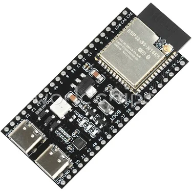
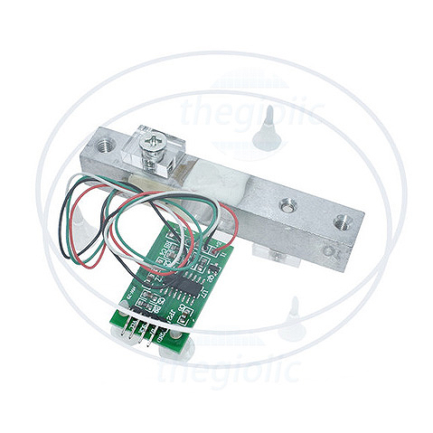
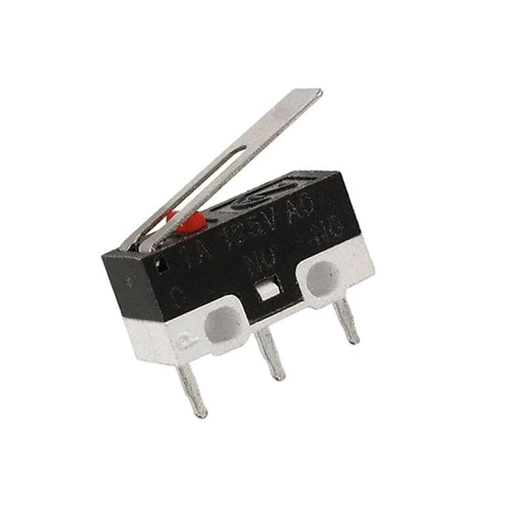
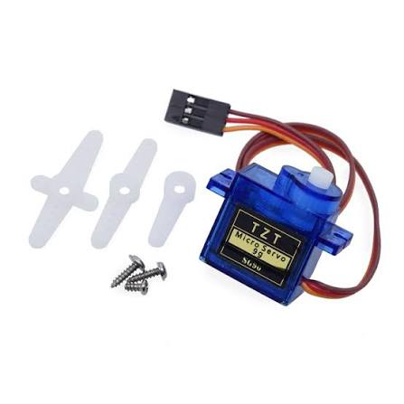
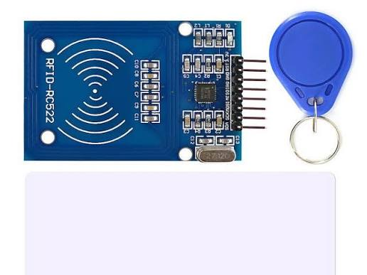
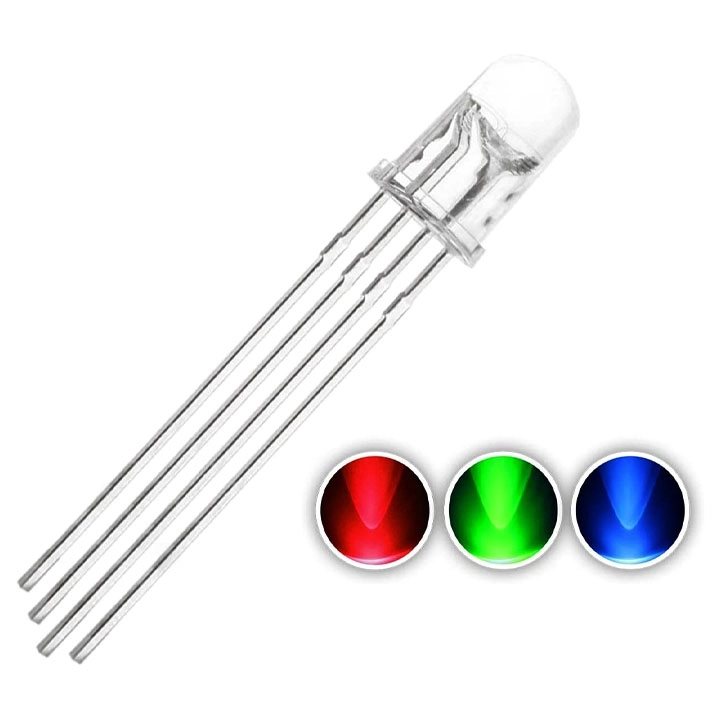
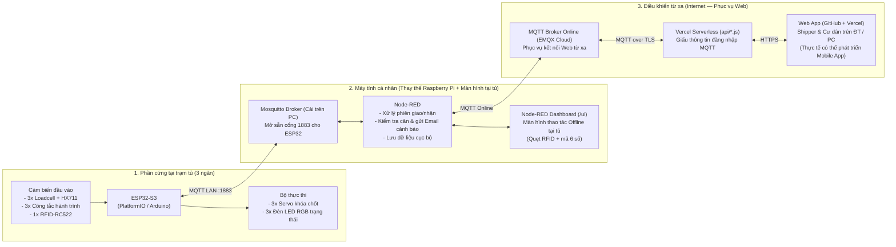

# SMART LOCKER IoT — HỆ THỐNG TỦ GIAO NHẬN HÀNG THÔNG MINH

- **Sinh viên thực hiện:** Tạ Thanh Hải
- **Nền tảng:** ESP32-S3 (PlatformIO / Arduino) · MQTT (Mosquitto & EMQX Cloud) · Node-RED & Dashboard · Web App (GitHub + Vercel Serverless)

---

## 1. Đặt bài toán

Tại các **khu chung cư, chung cư mini**, khâu giao nhận hàng hóa chặng cuối thường gặp nhiều bất cập:

- **Lệch thời gian:** Cư dân đi làm, đi học cả ngày; shipper không thể lên tận căn hộ khi vắng chủ.
- **Rủi ro mất cắp, cầm nhầm:** Hàng phải gửi ở sảnh hoặc bàn bảo vệ, dễ thất lạc, lấy nhầm hoặc hư hỏng.
- **Khó xác thực giao nhận:** Không có bằng chứng shipper đã bỏ hàng vào tủ hay chưa, hoặc hàng có bị lấy mất trong lúc chờ nhận hay không.
- **Chưa tận dụng hạ tầng sẵn có:** Hầu hết cư dân chung cư đều có sẵn **thẻ từ (thẻ thang máy / thẻ mở cửa phòng)** nhưng chưa tích hợp vào việc nhận hàng.

---

## 2. Giải pháp & Lợi ích

### Giải pháp đề xuất
Xây dựng hệ thống **Smart Locker IoT** đặt tại sảnh chung cư, hoạt động 24/7 với chi phí thấp:

- Ở phiên bản triển khai thực tế, trạm tủ sẽ dùng **một máy tính nhúng (như Raspberry Pi) + màn hình cảm ứng** gắn ngay tại tủ kết nối với mạch điều khiển phần cứng.
- Để thuận tiện cho bản demo, hệ thống được tách đôi giữa **Máy tính cá nhân** (đóng vai trò máy tính nhúng + màn hình tại tủ, kết nối nội bộ với **ESP32-S3** qua **Mosquitto LAN**) và **EMQX Cloud** (chủ yếu phục vụ **Web App** điều khiển từ xa trên GitHub + **Vercel Serverless**; thực tế có thể phát triển thành **Mobile App** riêng).

### Lợi ích nổi bật
1. **Lấy hàng nhanh & Offline bằng thẻ chung cư:** Cư dân gắn sẵn thẻ thang máy/thẻ phòng (13.56 MHz) với tài khoản; đi làm về chỉ cần quẹt thẻ + nhập mã 6 số tại tủ để nhận hàng ngay cả khi mất Internet.
2. **Xác thực & Tự động hóa:** Chống shipper mở tủ nhưng không bỏ hàng và tự động hoàn tất đơn khi lấy hết hàng. 
3. **Trực quan & An toàn:** Đèn báo giúp người dùng xác nhận cửa đã đóng chặt; phát hiện cạy tủ hoặc bất thường để gửi email cảnh báo cho admin ngay.
4. **Bảo mật kết nối Web:** Mọi yêu cầu từ xa đi qua **Vercel Serverless** (`api/*.js`), giấu hoàn toàn tài khoản/mật khẩu **EMQX Cloud** phía server, không để lộ thông tin MQTT ra trình duyệt.
5. **Không mất dữ liệu khi tắt máy:** Dữ liệu hệ thống được lưu trực tiếp trên máy tính cá nhân, khởi động lại vẫn giữ nguyên trạng thái tủ và đơn hàng.

---

## 3. Quy mô Demo & Phần cứng sử dụng

Dự án xây dựng **mô hình demo quy mô nhỏ gồm 3 ngăn tủ** (Trạm `A`: Tủ 1, Tủ 2, Tủ 3).

### 3.1. Máy tính cá nhân (PC / Laptop) — SL: 1 *(thay thế tạm cho Raspberry Pi + màn hình tại tủ)*
- **Mục đích:** Đóng vai trò máy chủ trung tâm: chạy Node-RED xử lý nghiệp vụ, cài sẵn **Mosquitto Broker mở cổng `1883` trong mạng LAN** để ESP32 kết nối trực tiếp, **lưu trữ toàn bộ dữ liệu** (tài khoản cư dân, thẻ từ, trạng thái tủ, đơn hàng, lịch sử hoạt động) và hiển thị **Node-RED Dashboard (`/ui`)** làm màn hình thao tác offline tại tủ.

### 3.2. Vi điều khiển ESP32-S3 DevKit (N16R8) — SL: 1
- **Mục đích:** Kết nối Wi-Fi/LAN tới Mosquitto trên máy tính để gửi dữ liệu cảm biến, mã thẻ RFID và nhận lệnh điều khiển chốt khóa, đèn báo cho 3 ngăn tủ.

### 3.3. Cảm biến tải trọng Loadcell (0–5 kg) + Mạch HX711 — SL: 3 bộ
- **Mục đích:** Gắn dưới đáy mỗi ngăn tủ để cân khối lượng gói hàng, xác thực shipper đã bỏ hàng thật và tự nhận biết khi khách đã lấy hết hàng.

### 3.4. Công tắc hành trình — SL: 3 cái
- **Mục đích:** Phát hiện trạng thái đóng/mở thực tế của từng cửa tủ (kết hợp lực đẩy giúp cửa tự bung mở khi nhả chốt), tự khóa chốt khi đóng và phát hiện hành vi cạy phá.

### 3.5. Động cơ Servo SG90 *(+ nguồn 5V ngoài)* — SL: 3 cái
- **Mục đích:** Cơ cấu thực thi đóng/nhả chốt khóa cơ khí cho từng ngăn tủ.

### 3.6. Đầu đọc RFID-RC522 (13.56 MHz) & Thẻ từ — SL: 1 bộ
- **Mục đích:** Đọc UID từ **thẻ cư dân có sẵn (thẻ thang máy / thẻ mở cửa phòng 13.56 MHz)** khi người dùng thao tác nhận hàng trực tiếp tại màn hình tủ ở sảnh chung cư.

### 3.7. Đèn LED RGB chỉ thị trạng thái — SL: 3 cái
- **Mục đích:** Gắn dưới mỗi ngăn tủ để hiển thị trạng thái bằng màu sắc (đang mở / đã đóng khóa / lỗi), giúp người dùng dễ dàng xác nhận trực quan xem mình đã đóng cửa tủ chặt thật chưa.

---

## 4. Sơ đồ khối hệ thống

---

## 5. Luồng hoạt động chính

> **Nguyên tắc:** **ESP32-S3** chỉ đọc cảm biến, gửi trạng thái thô và chấp hành lệnh (mở chốt, đổi màu LED); mọi quyết định giao/nhận, lưu dữ liệu và cảnh báo do **Node-RED** trên máy tính xử lý.

### 5.1. Luồng Shipper giao hàng (qua Web từ xa)
1. Shipper mở Web App trên điện thoại, nhập SĐT cư dân (không cần tài khoản) và bấm thêm tủ (`+`) tùy ý theo số lượng đơn hàng cần gửi.
2. Yêu cầu đi qua **Vercel Serverless → EMQX Cloud → Node-RED**; **hệ thống tự động cấp phát tủ trống** (shipper không tự chọn số tủ) và gửi lệnh mở xuống **ESP32-S3**.
3. **ESP32-S3** quay **Servo** nhả chốt → cửa tủ tự bung mở ra, đồng thời bật **LED RGB** báo tủ đang mở; Shipper bỏ hàng và đẩy đóng cửa.
4. **Công tắc hành trình** báo đóng → **ESP32-S3** tự khóa Servo ngay, đọc cân **Loadcell** rồi gửi sự kiện về Node-RED.
5. Node-RED kiểm tra trạng thái cửa, khối lượng hàng và chốt lượt giao xong → **tạo đơn hàng**, chuyển **LED RGB** sang trạng thái đã khóa, và **gửi email về Gmail cư dân đã đăng ký kèm mã nhận hàng** (nếu tủ trống thì trả lại tủ trống).

### 5.2. Luồng Khách hàng (Cư dân) nhận hàng
- **Tại tủ (Offline qua Dashboard):** Cư dân quẹt thẻ chung cư lên đầu đọc **RFID-RC522** → **ESP32-S3** gửi mã thẻ lên Node-RED → cư dân nhập mã 6 số trên màn hình **Node-RED Dashboard** → Node-RED lệnh cho **ESP32-S3** nhả Servo mở đồng loạt các ngăn có hàng (cửa tự bung mở).
- **Từ xa (Online qua Web App):** Cư dân đăng nhập Web App xem danh sách tủ có hàng và bấm mở từng tủ hoặc tất cả tủ từ xa (ví dụ mở cho người thân lấy hộ).
- Khi lấy hàng xong và đóng cửa: **ESP32-S3** khóa chốt Servo, cân **Loadcell** báo về `0 g` → Node-RED kiểm tra hợp lệ rồi tự hoàn tất đơn và giải phóng tủ.

### 5.3. Giám sát bất thường
- Nếu cửa mở khi chưa được cấp phép (cạy cửa) hoặc khối lượng thay đổi bất thường, **ESP32-S3** báo ngay về Node-RED để chuyển **LED RGB** sang màu cảnh báo và gửi email thông báo.

```mermaid
flowchart TD
    subgraph Ship["Luồng Shipper (Giao hàng)"]
        S1["1. Nhập SĐT & bấm thêm tủ (+) trên Web App"] --> S2["2. Node-RED tự cấp phát tủ trống & lệnh ESP32 mở"]
        S2 --> S3["3. Servo nhả chốt, cửa tự bung mở → Bỏ hàng & đóng cửa"]
        S3 --> S4["4. ESP32 tự khóa Servo + cân Loadcell"]
        S4 --> S5["5. Node-RED kiểm tra xong → Tạo đơn & gửi Gmail kèm mã nhận hàng"]
    end

    subgraph Khach["Luồng Khách hàng (Nhận hàng)"]
        K1["1. Quẹt thẻ RFID + mã 6 số tại Dashboard\n(hoặc bấm Mở tủ trên Web App)"] --> K2["2. Node-RED lệnh ESP32 nhả Servo → cửa tự bung mở"]
        K2 --> K3["3. Cư dân lấy hàng & đóng cửa"]
        K3 --> K4["4. ESP32 tự khóa Servo + cân Loadcell về 0g"]
        K4 --> K5["5. Node-RED hoàn tất đơn & trả tủ trống"]
    end
```

